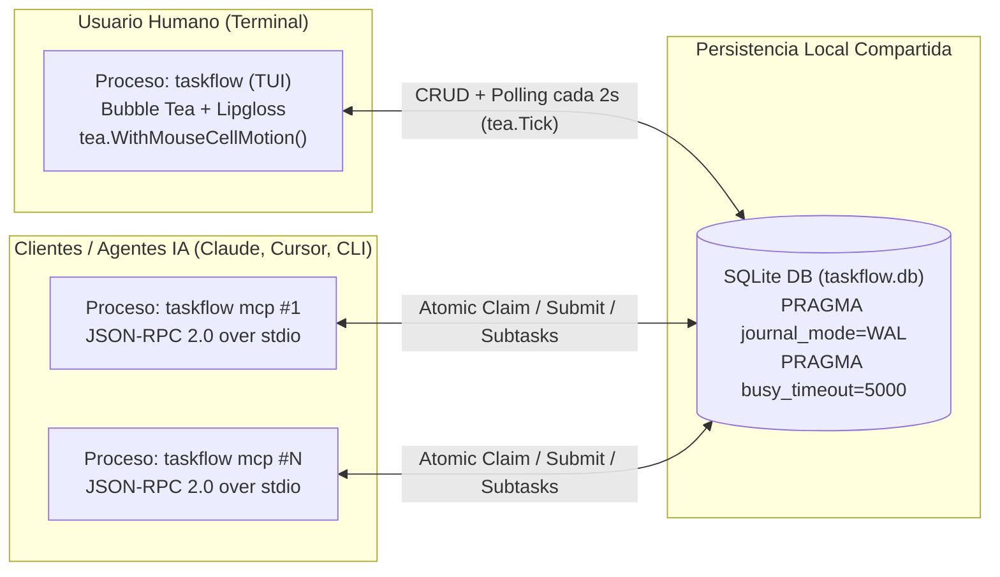
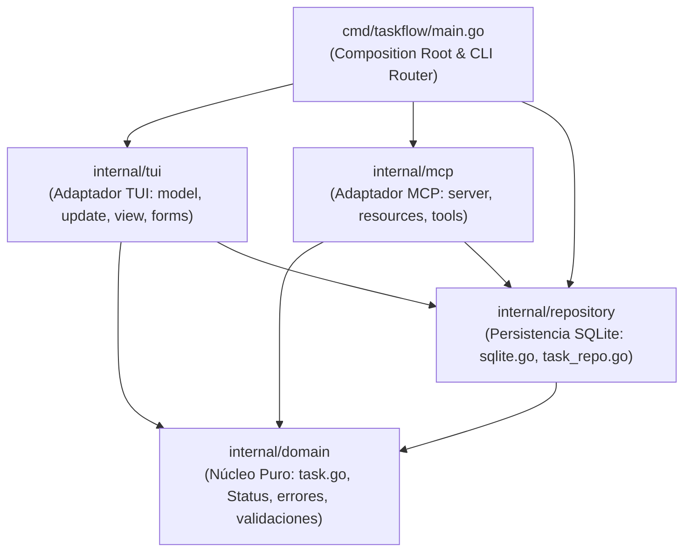
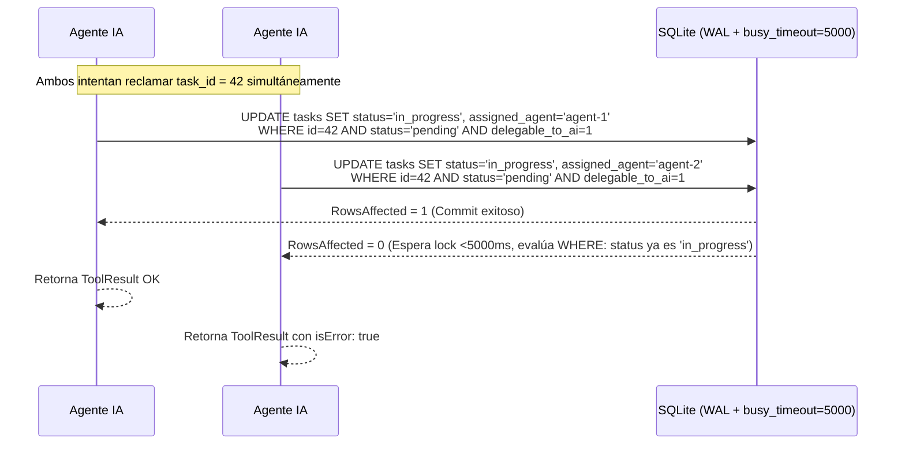

# ARCH-001: Arquitectura del Sistema `taskflow` (TUI + Servidor MCP en Go)

- **Especificación Origen:** [`./docs/specs/SPEC-001.md`](../specs/SPEC-001.md)
- **Estado:** Aprobado
- **Binario Objetivo:** `taskflow` (Go 1.23+, `CGO_ENABLED=0`)

---

## 1. Visión Arquitectónica y Principios de Diseño

`taskflow` se diseña como un **binario único auto-contenido** en Go que opera bajo dos modos de ejecución mutuamente excluyentes por proceso (`taskflow` para la TUI interactiva y `taskflow mcp` para el servidor Model Context Protocol), pero **concurrentes sobre el mismo archivo de base de datos SQLite en modo WAL**.

### Principios Rectores
1. **Clean Architecture Pragmática (`internal/`)**: Separación estricta entre el dominio puro (`internal/domain`), la infraestructura de persistencia (`internal/repository`) y los adaptadores primarios de entrada (`internal/tui` e `internal/mcp`).
2. **Concurrencia Multi-Proceso Libre de Bloqueos**: Sincronización entre el proceso TUI del usuario y múltiples procesos `taskflow mcp` invocados por agentes IA mediante SQLite `WAL` (`PRAGMA journal_mode=WAL;`), `busy_timeout=5000` y sentencias `UPDATE` atómicas con validación de `RowsAffected`.
3. **Aislamiento Estricto del Canal `stdio` en MCP**: En modo `taskflow mcp`, `os.Stdout` pertenece exclusivamente al transporte JSON-RPC 2.0; cualquier diagnóstico o log se redirige a `os.Stderr`.
4. **Cero Dependencias CGO (`CGO_ENABLED=0`)**: Uso de `modernc.org/sqlite` para garantizar compilación cruzada limpia en un único ejecutable estático.

---

## 2. Diagrama de Contexto y Componentes



### Arquitectura de Capas Internas



---

## 3. Estructura de Paquetes y Responsabilidades

```text
taskflow/
├── cmd/
│   └── taskflow/
│       └── main.go           # Entrypoint CLI (enrutamiento TUI vs subcomando mcp, flags --db)
├── internal/
│   ├── domain/
│   │   └── task.go           # Entidad Task, tipo Status, transiciones válidas y errores de dominio
│   ├── repository/
│   │   ├── sqlite.go         # Inicialización modernc.org/sqlite, PRAGMAs WAL/busy_timeout y DDL
│   │   └── task_repo.go      # Operaciones CRUD, serialización JSON de tags y Claim/Submit atómicos
│   ├── mcp/
│   │   └── server.go         # Servidor MCP sobre stdio: 1 Resource y 4 Tools
│   └── tui/
│       ├── model.go          # Estado Bubble Tea, geometría de hitboxes, foco y estado de modales
│       ├── update.go         # Loop de eventos: teclado, tea.MouseMsg (clic/doble clic/scroll) y tea.Tick (2s)
│       ├── view.go           # Renderizado Lipgloss de 4 columnas Kanban, barra de botones y modales
│       └── forms.go          # Componentes de formulario (crear/editar tarea) y confirmación de borrado
├── go.mod
└── go.sum
```

---

## 4. Diseño Detallado por Capa

### 4.1. Capa de Dominio (`internal/domain/task.go`)

El paquete `domain` no tiene dependencias externas (solo librería estándar de Go).

- **Estados Tipados (`Status`)**:
  ```go
  type Status string

  const (
      StatusPending    Status = "pending"
      StatusInProgress Status = "in_progress"
      StatusReview     Status = "review"
      StatusDone       Status = "done"
  )
  ```
- **Entidad `Task`**:
  ```go
  type Task struct {
      ID            int64     `json:"id"`
      Title         string    `json:"title"`
      Description   string    `json:"description"`
      Status        Status    `json:"status"`
      DelegableToAI bool      `json:"delegable_to_ai"`
      Tags          []string  `json:"tags"`
      AssignedAgent string    `json:"assigned_agent"`
      AINotes       string    `json:"ai_notes"`
      CreatedAt     time.Time `json:"created_at"`
      UpdatedAt     time.Time `json:"updated_at"`
  }
  ```
- **Errores Centinela de Dominio**:
  - `ErrTaskNotFound`: La tarea solicitada no existe.
  - `ErrTaskNotClaimable`: La tarea no existe, no está en `pending`, no tiene `delegable_to_ai = true` o ya fue reclamada por otro agente.
  - `ErrInvalidStatusTransition`: Transición de estado inválida (ej. intentar hacer `submit_task_result` sobre una tarea que no está en `in_progress`).
  - `ErrValidation`: Título vacío o estado desconocido.

---

### 4.2. Capa de Persistencia y Concurrencia (`internal/repository/`)

#### Configuración de Conexión (`sqlite.go`)
- Driver: `modernc.org/sqlite` (registrado como `"sqlite"` en `database/sql`).
- Al abrir la base de datos (`OpenSQLite(dbPath string)`):
  1. Se ejecutan los `PRAGMA` obligatorios en la conexión:
     ```sql
     PRAGMA journal_mode = WAL;
     PRAGMA busy_timeout = 5000;
     PRAGMA synchronous = NORMAL;
     PRAGMA foreign_keys = ON;
     ```
  2. Se ejecuta la migración idempotente definida en `SPEC-001 §3`:
     ```sql
     CREATE TABLE IF NOT EXISTS tasks (
         id INTEGER PRIMARY KEY AUTOINCREMENT,
         title TEXT NOT NULL,
         description TEXT DEFAULT '',
         status TEXT NOT NULL DEFAULT 'pending',
         delegable_to_ai BOOLEAN NOT NULL DEFAULT 1,
         tags TEXT DEFAULT '[]',
         assigned_agent TEXT DEFAULT '',
         ai_notes TEXT DEFAULT '',
         created_at DATETIME DEFAULT CURRENT_TIMESTAMP,
         updated_at DATETIME DEFAULT CURRENT_TIMESTAMP
     );

     CREATE INDEX IF NOT EXISTS idx_tasks_status_ai ON tasks(status, delegable_to_ai);
     ```

#### Contratos del Repositorio (`task_repo.go`)
- `Create(ctx, *domain.Task) (int64, error)`: Serializa `Tags` (`[]string`) a JSON (`"[]"`, si es vacío) e inserta la tarea.
- `GetByID(ctx, id int64) (*domain.Task, error)`: Obtiene una tarea y deserializa `tags` desde JSON.
- `ListAll(ctx) ([]domain.Task, error)`: Retorna todas las tareas ordenadas para el tablero Kanban de la TUI.
- `ListAvailableForAI(ctx, tagFilter string) ([]domain.Task, error)`:
  - Filtra `WHERE status = 'pending' AND delegable_to_ai = 1`.
  - Si `tagFilter != ""`, añade filtro sobre la columna JSON `tags` (`AND tags LIKE ?` con patrón `%"tag"%` para coincidencia exacta de etiqueta dentro del JSON array).
- `ClaimTask(ctx, taskID int64, agentName string) error` (**Garantía CA-1**):
  - Ejecuta una única sentencia SQL atómica sin `SELECT` previo:
    ```sql
    UPDATE tasks
    SET status = 'in_progress',
        assigned_agent = ?,
        updated_at = CURRENT_TIMESTAMP
    WHERE id = ?
      AND status = 'pending'
      AND delegable_to_ai = 1;
    ```
  - Si `RowsAffected() == 0`, retorna `domain.ErrTaskNotClaimable`.
- `SubmitTaskResult(ctx, taskID int64, aiNotes string, requiresReview bool) error`:
  - Determina estado destino (`review` si `requiresReview == true`, `done` en caso contrario).
  - Ejecuta `UPDATE` atómico condicionado a `WHERE id = ? AND status = 'in_progress'`.
  - Si `RowsAffected() == 0`, retorna `domain.ErrInvalidStatusTransition`.
- Métodos de soporte TUI:
  - `Update(ctx, *domain.Task) error` (edición de título, descripción, tags, delegable_to_ai).
  - `ToggleDelegableToAI(ctx, id int64) error`.
  - `ApproveTask(ctx, id int64) error` (mueve a `done`).
  - `ReturnToPending(ctx, id int64) error` (cambia `status = 'pending'`, `assigned_agent = ''`).
  - `Delete(ctx, id int64) error`.

#### Diagrama de Secuencia: Reclamo Atómico Concurrente (CA-1)



---

### 4.3. Capa del Servidor MCP (`internal/mcp/server.go`)

Implementado con `github.com/mark3labs/mcp-go` sobre transporte `stdio`.

#### Protección del Canal `stdio` (CA-2)
- En `cmd/taskflow/main.go`, antes de inicializar el repositorio o el servidor MCP cuando `os.Args[1] == "mcp"`:
  ```go
  log.SetOutput(os.Stderr)
  ```
- Ningún paquete interno escribe jamás en `os.Stdout`.

#### Registro de Capacidades MCP
1. **Resource `tasks://pending-for-ai`**:
   - Nombre: `"Pending AI Tasks"`
   - MIME Type: `"application/json"`
   - Handler: Invoca `repo.ListAvailableForAI(ctx, "")` y serializa el slice como JSON array (`[]` si no hay elementos).
2. **Tool `list_available_tasks`**:
   - Parámetro opcional: `tag_filter` (`string`).
   - Handler: Invoca `repo.ListAvailableForAI(ctx, tagFilter)` y proyecta cada tarea a `{id, title, description, tags, created_at}` en JSON.
3. **Tool `claim_task`**:
   - Parámetros requeridos: `task_id` (`number`), `agent_name` (`string`).
   - Handler: Invoca `repo.ClaimTask(ctx, taskID, agentName)`. Si devuelve error (incluyendo `ErrTaskNotClaimable`), retorna `mcp.NewToolResultError(...)` (`isError: true`).
4. **Tool `submit_task_result`**:
   - Parámetros requeridos: `task_id` (`number`), `ai_notes` (`string`), `requires_review` (`boolean`).
   - Handler: Invoca `repo.SubmitTaskResult(ctx, taskID, aiNotes, requiresReview)`. Si falla, retorna `mcp.NewToolResultError(...)`.
5. **Tool `create_subtask`**:
   - Parámetros: `title` (`string`, requerido), `description` (`string`, opcional), `delegable_to_ai` (`boolean`, requerido), `tags` (`[]string`, opcional).
   - Handler: Crea la tarea en estado `pending` y retorna `{"id": createdID}` como texto JSON.

---

### 4.4. Capa de Interfaz de Terminal (`internal/tui/`)

Implementada sobre la arquitectura Elm (`Model - Update - View`) de `charmbracelet/bubbletea` con `tea.WithAltScreen()` y `tea.WithMouseCellMotion()`.

#### Estructura Visual y Sistema de Coordenadas / Hitboxes (CA-3)
Para soportar selección por clic, doble clic, scroll por columna y botones de acción sin depender de librerías externas de zonas, `Model` calcula determinísticamente las **Hitboxes** en función de `width` y `height` recibidos en `tea.WindowSizeMsg`:

```text
+----------------------------------------------------------------------------------+
| Y=0..1: Cabecera: TASKFLOW Kanban | Botones: [+ Nueva Tarea] [Toggle IA]         |
|         [Aprobar / Mover a Done] [Devolver a Pending]                            |
+--------------------+--------------------+--------------------+-------------------+
| Col 0: PENDING     | Col 1: IN PROGRESS | Col 2: REVIEW      | Col 3: DONE       |
| (X: 0..W/4)        | (X: W/4..2W/4)     | (X: 2W/4..3W/4)    | (X: 3W/4..W)      |
|                    |                    |                    |                   |
| +----------------+ | +----------------+ | +----------------+ | +---------------+ |
| | #1 Título      | | | #2 Título      | | | #3 Título      | | | #4 Título     | |
| | [AI] [go,cli]  | | | @claude-agent  | | | [AI]           | | |               | |
| +----------------+ | +----------------+ | +----------------+ | +---------------+ |
| ...                | ...                | ...                | ...               |
+--------------------+--------------------+--------------------+-------------------+
| Y=H-1: Barra de estado / Atajos: [n] Nueva [e] Editar [a] Aprobar [d] Borrar ... |
+----------------------------------------------------------------------------------+
```

- **Registro de Hitboxes (`internal/tui/model.go`)**:
  ```go
  type Rect struct {
      X, Y, W, H int
  }
  func (r Rect) Contains(x, y int) bool {
      return x >= r.X && x < r.X+r.W && y >= r.Y && y < r.Y+r.H
  }
  ```
  - `buttonRects map[ActionID]Rect`: Coordenadas exactas de los 4 botones de acción rápida:
    1. `ActionNewTask` (`[+ Nueva Tarea]`)
    2. `ActionToggleAI` (`[Toggle IA]`)
    3. `ActionApprove` (`[Aprobar / Mover a Done]`)
    4. `ActionReturnPending` (`[Devolver a Pending]`)
  - `columnRects [4]Rect`: Límites horizontales y verticales de cada una de las 4 columnas (`PENDING`, `IN PROGRESS`, `REVIEW`, `DONE`).
  - `cardRects []CardHitbox`: Lista de `{ColumnIdx, TaskIndex, TaskID, Rect}` generada según el offset de scroll de cada columna y la altura fija de tarjeta (`cardHeight`).

#### Manejo de Eventos de Ratón (`internal/tui/update.go`)
1. **`tea.MouseButtonLeft` (`tea.MouseActionPress`)**:
   - Si hay un modal abierto, procesa los botones del modal o cierre.
   - Si `(msg.X, msg.Y)` cae dentro de `buttonRects[action]`, ejecuta la acción inmediatamente sobre la tarea seleccionada.
   - Si `(msg.X, msg.Y)` cae dentro de un `cardRects`:
     - Enfoca `activeCol = card.ColumnIdx` y `selectedRow[activeCol] = card.TaskIndex`.
     - **Detección de Doble Clic**: Compara `card.TaskID == lastClickTaskID` y `time.Since(lastClickTime) <= 350*time.Millisecond`. Si coincide, abre el **Modal de Detalle** mostrando `description` y `ai_notes`.
   - Si `(msg.X, msg.Y)` cae dentro de `columnRects[col]` (en espacio vacío), cambia `activeCol = col`.
2. **`tea.MouseButtonWheelUp` / `tea.MouseButtonWheelDown`**:
   - Si el modal de detalle está abierto, desplaza el contenido del modal.
   - Si el cursor está sobre la columna `col` (`columnRects[col].Contains(msg.X, msg.Y)`), decrementa/incrementa el índice de scroll y selección de esa columna.

#### Sincronización en Tiempo Real (`tea.Tick` cada 2 segundos - CA-4)
- Al iniciar la TUI (`Init()`), se dispara `tickCmd()` con intervalo de `2 * time.Second`.
- En `Update()`, al recibir `tickMsg`:
  1. Dispara en paralelo la recarga de tareas desde SQLite (`loadTasksCmd(repo)`) y el siguiente `tickCmd()`.
  2. Al recibir `tasksLoadedMsg`, actualiza las 4 columnas preservando el `selectedTaskID` si la tarea sigue en la misma columna o ajustando el cursor de forma segura si un agente IA movió la tarea a `IN PROGRESS`, `REVIEW` o `DONE`.

---

## 5. Matriz de Trazabilidad con Criterios de Aceptación (`SPEC-001 §6`)

| Criterio | Requisito de `SPEC-001.md` | Mecanismo Arquitectónico en `ARCH-001.md` |
| :--- | :--- | :--- |
| **CA-1** | Concurrencia SQLite en `claim_task` sin `SQLITE_BUSY` y con exactamente 1 ganador. | `modernc.org/sqlite` con `PRAGMA journal_mode=WAL`, `PRAGMA busy_timeout=5000`, y `UPDATE ... WHERE id=? AND status='pending' AND delegable_to_ai=1` verificando `RowsAffected() == 1`. |
| **CA-2** | Integridad JSON-RPC del servidor `taskflow mcp` listando 4 tools y 1 resource. | Enrutador CLI en `cmd/taskflow/main.go` redirigiendo `log.SetOutput(os.Stderr)` y servidor `mark3labs/mcp-go` en `internal/mcp/server.go` sobre `stdio`. |
| **CA-3** | Selección de tareas con clic izquierdo, scroll con rueda y aprobación con clic en botón. | `tea.WithMouseCellMotion()`, motor de `Rect` hitboxes en `internal/tui/` para tarjetas, columnas y barra de 4 botones clicables (`[Aprobar / Mover a Done]`, etc.). |
| **CA-4** | Sincronización en vivo en la TUI en `< 3` segundos tras cambios vía MCP. | Loop `tea.Tick(2 * time.Second)` en `internal/tui/update.go` leyendo el estado comprometido en SQLite WAL. |
