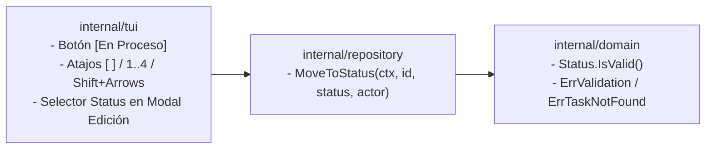

# ARCH-002: Diseño Técnico para Gestión Manual de Estados en TUI y Repositorio

- **Especificación Origen:** [`./docs/specs/SPEC-002.md`](../specs/SPEC-002.md)
- **Arquitectura Base:** [`./docs/arqs/ARCH-001.md`](../arqs/ARCH-001.md)

---

## 1. Impacto en Capas



- **`internal/domain`**: Sin cambios estructurales; reutiliza `Status`, `Status.IsValid()` y errores existentes.
- **`internal/mcp`**: Sin modificaciones. Los flujos atómicos de agentes (`ClaimTask`, `SubmitTaskResult`) permanecen intactos.
- **`internal/repository/task_repo.go`**: Añade `MoveToStatus` con actualización atómica en SQLite WAL.
- **`internal/tui/`**: Actualiza `model.go`, `forms.go`, `update.go` y `view.go` manteniendo sincronizadas las hitboxes de botones y del selector de estado en el formulario.

---

## 2. Diseño por Componente

### 2.1. Repositorio (`internal/repository/task_repo.go`)

```go
func (r *TaskRepository) MoveToStatus(ctx context.Context, taskID int64, status domain.Status, actor string) error
```

- Valida `status.IsValid()` antes de tocar SQLite.
- Ejecuta un `UPDATE` parametrizado según el estado destino:
  - Si `status == domain.StatusPending`:
    ```sql
    UPDATE tasks
    SET status = 'pending',
        assigned_agent = '',
        updated_at = CURRENT_TIMESTAMP
    WHERE id = ?;
    ```
  - Si `status == domain.StatusInProgress`:
    ```sql
    UPDATE tasks
    SET status = 'in_progress',
        assigned_agent = CASE WHEN assigned_agent = '' THEN ? ELSE assigned_agent END,
        updated_at = CURRENT_TIMESTAMP
    WHERE id = ?;
    ```
  - Para `review` y `done`:
    ```sql
    UPDATE tasks
    SET status = ?,
        updated_at = CURRENT_TIMESTAMP
    WHERE id = ?;
    ```
- Verifica `RowsAffected() == 0` -> retorna `domain.ErrTaskNotFound`.

### 2.2. Estado y Hitboxes TUI (`internal/tui/model.go`)

- Se añade `ActionInProgress ActionID = "in_progress"` al mapa `buttonRects` en `recalculateLayout()`:
  1. `[+ Nueva Tarea]`
  2. `[Toggle IA]`
  3. `[En Proceso]`
  4. `[Aprobar / Mover a Done]`
  5. `[Devolver a Pending]`
- Se añaden campos en `Model` para el selector de estado del formulario:
  - `formStatus domain.Status`: Almacena el estado seleccionado durante la edición (`e`).
  - `formStatusRect Rect`: Hitbox aproximada/calculada para clic de ratón en el modal de edición.
- En el formulario de edición (`isEditForm == true`), los índices de foco (`formFocusIdx`) serán:
  - `0`: Título (`titleInput`)
  - `1`: Descripción (`descInput`)
  - `2`: Tags (`tagsInput`)
  - `3`: Delegable a IA (`delegableToAI`)
  - `4`: Estado (`formStatus`) — solo en modo edición
  - `5`: Guardar
  - `6`: Cancelar
  *(En creación `isEditForm == false`, se mantiene el ciclo sin el selector de estado o se salta automáticamente el índice 4).*

### 2.3. Flujo de Eventos (`internal/tui/update.go`)

1. **Botón `[En Proceso]`**:
   - `executeQuickAction(ActionInProgress)` ejecuta `m.moveTaskStatusCmd(sel.ID, domain.StatusInProgress, "humano")`.
2. **Atajos en `ModeBoard`**:
   - `]` o `shift+right`: Calcula `nextCol = m.activeCol + 1` (si `< 3`) y llama `moveTaskStatusCmd(sel.ID, ColumnOrder[nextCol], "humano")`, moviendo además `m.activeCol = nextCol` para seguir visualmente a la tarjeta.
   - `[` o `shift+left`: Calcula `prevCol = m.activeCol - 1` (si `> 0`) y llama `moveTaskStatusCmd(sel.ID, ColumnOrder[prevCol], "humano")`, actualizando `m.activeCol = prevCol`.
   - `1`, `2`, `3`, `4`: Mueven la tarea seleccionada directamente a `ColumnOrder[0..3]` y actualizan `m.activeCol`.
3. **Formulario (`submitForm`)**:
   - En modo edición (`isEditForm == true`), usa `m.formStatus` en lugar de forzar `existing.Status`. Si `m.formStatus == domain.StatusPending`, limpia `assigned_agent = ""`; si `m.formStatus == domain.StatusInProgress` y `assigned_agent == ""`, asigna `"humano"`.
