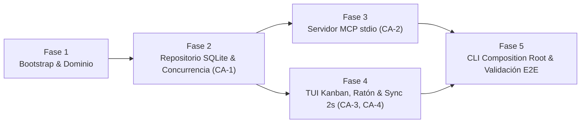

# PLAN-001: Plan de Implementación y Verificación de `taskflow`

- **Especificación Origen:** [`./docs/specs/SPEC-001.md`](../specs/SPEC-001.md)
- **Documento de Arquitectura:** [`./docs/arqs/ARCH-001.md`](../arqs/ARCH-001.md)
- **Skills Aplicables:** `sdd-spec-guardrail`, `golang-idiomatic-clean-arch`, `sqlite-concurrency-go`, `mcp-server-go-stdio`, `charm-tui-mouse-layout`

---

## 1. Resumen de Fases de Ejecución



---

## 2. Desglose Detallado de Tareas por Fase

### Fase 1: Inicialización del Módulo Go y Capa de Dominio (`internal/domain`)
**Objetivo:** Configurar el módulo Go 1.23+ con dependencias limpias (`CGO_ENABLED=0`) y construir el núcleo de dominio libre de dependencias externas.

1. **T1.1 — Inicializar `go.mod` y dependencias base**:
   - Inicializar módulo Go (`go mod init taskflow`).
   - Instalar dependencias requeridas por `SPEC-001 §2`:
     - `modernc.org/sqlite`
     - `github.com/charmbracelet/bubbletea`
     - `github.com/charmbracelet/lipgloss`
     - `github.com/charmbracelet/bubbles`
     - `github.com/mark3labs/mcp-go`
2. **T1.2 — Implementar `internal/domain/task.go`**:
   - Definir tipo `Status` y constantes `StatusPending` (`"pending"`), `StatusInProgress` (`"in_progress"`), `StatusReview` (`"review"`), `StatusDone` (`"done"`).
   - Definir struct `Task` con etiquetas JSON exactas según `SPEC-001 §3` y `§4.2`.
   - Definir errores centinela (`ErrTaskNotFound`, `ErrTaskNotClaimable`, `ErrInvalidStatusTransition`, `ErrValidation`) y funciones de validación de entidad.
3. **T1.3 — Tests unitarios de dominio (`internal/domain/task_test.go`)**:
   - Validar transiciones de estado permitidas y validación de campos obligatorios (`title`).

---

### Fase 2: Persistencia SQLite en Modo WAL y Operaciones Atómicas (`internal/repository`)
**Objetivo:** Implementar el acceso a datos sobre `modernc.org/sqlite` cumpliendo el esquema de `SPEC-001 §3` y el criterio de aceptación **CA-1**.

1. **T2.1 — Implementar `internal/repository/sqlite.go`**:
   - Función `NewSQLiteDB(dbPath string) (*sql.DB, error)` usando el driver `"sqlite"`.
   - Configurar y verificar pragmas de concurrencia:
     - `PRAGMA journal_mode=WAL;`
     - `PRAGMA busy_timeout=5000;`
     - `PRAGMA synchronous=NORMAL;`
     - `PRAGMA foreign_keys=ON;`
   - Ejecutar migración automática de la tabla `tasks` y el índice `idx_tasks_status_ai` (`SPEC-001 §3`).
2. **T2.2 — Implementar `internal/repository/task_repo.go`**:
   - Serialización/deserialización segura de `tags` (`[]string` <-> JSON `TEXT`, garantizando `"[]"` por defecto).
   - Operaciones CRUD para la TUI: `Create`, `GetByID`, `ListAll`, `Update`, `Delete`, `ToggleDelegableToAI`, `ApproveTask` (`-> done`), `ReturnToPending` (`status = 'pending', assigned_agent = ''`).
   - Operaciones para MCP:
     - `ListAvailableForAI(ctx, tagFilter string)`: filtra `status = 'pending' AND delegable_to_ai = 1` y opcionalmente `tags LIKE ?`.
     - `ClaimTask(ctx, taskID int64, agentName string)`: `UPDATE` atómico verificando `RowsAffected() == 1`. Si es `0`, retorna `domain.ErrTaskNotClaimable`.
     - `SubmitTaskResult(ctx, taskID int64, aiNotes string, requiresReview bool)`: `UPDATE` atómico condicionado a `status = 'in_progress'` transicionando a `'review'` o `'done'`.
3. **T2.3 — Suite de tests de repositorio y concurrencia (`internal/repository/task_repo_test.go`)**:
   - Test de CRUD y filtrado por `tag_filter`.
   - **Test de Concurrencia CA-1**: Lanzar múltiples goroutines/conexiones concurrentes contra un archivo SQLite temporal en modo WAL intentando ejecutar `ClaimTask` sobre el mismo `task_id` al mismo tiempo. Verificar que exactamente 1 goroutine obtiene `nil`, el resto recibe `domain.ErrTaskNotClaimable`, y hay `0` errores `SQLITE_BUSY`.

---

### Fase 3: Servidor MCP sobre `stdio` (`internal/mcp`)
**Objetivo:** Exponer el resource y las 4 tools MCP sobre `stdio` cumpliendo `SPEC-001 §4.2` y el criterio **CA-2**.

1. **T3.1 — Implementar `internal/mcp/server.go`**:
   - Construir `NewServer(repo *repository.TaskRepository)` sobre `mark3labs/mcp-go`.
   - Registrar Resource `tasks://pending-for-ai` (`application/json`) que devuelve todas las tareas con `status = 'pending'` y `delegable_to_ai = 1`.
   - Registrar Tool `list_available_tasks` (input opcional `tag_filter`; output JSON con `id`, `title`, `description`, `tags`, `created_at`).
   - Registrar Tool `claim_task` (input `task_id`, `agent_name`; invoca `repo.ClaimTask`; si falla devuelve resultado con `isError: true`).
   - Registrar Tool `submit_task_result` (input `task_id`, `ai_notes`, `requires_review`; invoca `repo.SubmitTaskResult`; si falla devuelve `isError: true`).
   - Registrar Tool `create_subtask` (input `title`, `description`, `delegable_to_ai`, `tags`; inserta en `pending` y retorna el `id` creado).
   - Función `ServeStdio(repo *repository.TaskRepository) error` asegurando que ningún log se emita en `stdout`.
2. **T3.2 — Tests de integración de handlers MCP (`internal/mcp/server_test.go`)**:
   - Probar el ciclo completo de un agente IA: listar tareas disponibles -> reclamar tarea -> verificar que un segundo reclamo devuelve `isError: true` -> crear subtarea -> enviar resultado (`requires_review: true` y `requires_review: false`).

---

### Fase 4: Interfaz de Terminal Interactiva con Soporte de Ratón (`internal/tui`)
**Objetivo:** Implementar el tablero Kanban de 4 columnas en Bubble Tea con soporte completo de ratón, teclado y refresco en tiempo real cada 2 segundos (**CA-3** y **CA-4**).

1. **T4.1 — Implementar estado principal y geometría (`internal/tui/model.go`)**:
   - Definir `Model` con las tareas agrupadas en las 4 columnas (`PENDING`, `IN PROGRESS`, `REVIEW`, `DONE`), columna activa, índice seleccionado por columna, offset de scroll por columna y mapa de hitboxes (`Rect`).
   - Definir modos de vista: Tablero Principal, Modal de Detalle (doble clic / Enter), Modal de Formulario Crear/Editar (`n` / `e`) y Modal de Confirmación de Eliminación (`d`).
2. **T4.2 — Implementar formularios y modales (`internal/tui/forms.go`)**:
   - Formulario interactivo (usando `bubbles/textinput` y `bubbles/textarea`) con campos:
     - Título (`title`)
     - Descripción (`description`)
     - Tags separados por coma (`tags`)
     - Checkbox/Toggle `Delegable a IA` (`delegable_to_ai`)
   - Soporte de clic de ratón y navegación con `Tab`/`Shift+Tab`/`Enter`/`Esc` dentro del formulario.
3. **T4.3 — Implementar control de eventos y sincronización (`internal/tui/update.go`)**:
   - Manejo de `tea.WindowSizeMsg` recalculando dimensiones de columnas y hitboxes.
   - Manejo de `tea.MouseMsg`:
     - Clic izquierdo en los 4 botones de acción rápida:
       1. `[+ Nueva Tarea]`
       2. `[Toggle IA]`
       3. `[Aprobar / Mover a Done]`
       4. `[Devolver a Pending]`
     - Clic izquierdo en columna/tarjeta para seleccionar.
     - Doble clic izquierdo en tarjeta (`<= 350ms`) para abrir el modal de detalle con `description` y `ai_notes`.
     - Rueda del ratón (`WheelUp`/`WheelDown`) para desplazar la lista de la columna bajo el cursor o el modal de detalle.
   - Manejo de atajos de teclado (`n`, `e`, `a`, `d`, `r`, `q`/`Ctrl+C`, flechas/`hjkl`).
   - Loop `tea.Tick` cada 2 segundos para recargar desde SQLite en vivo sin perder la selección activa (**CA-4**).
4. **T4.4 — Implementar renderizado visual (`internal/tui/view.go`)**:
   - Renderizado Lipgloss de la barra superior con los 4 botones de acción rápida, las 4 columnas Kanban con contadores, badges de `assigned_agent` en `IN PROGRESS`, indicadores de IA/tags, y la barra inferior de ayuda/estado.
5. **T4.5 — Tests unitarios de TUI y hitboxes (`internal/tui/tui_test.go`)**:
   - Simular `tea.MouseMsg` (clic izquierdo sobre tarjeta, scroll de rueda, clic sobre botón `[Aprobar / Mover a Done]`) verificando que el estado y la base de datos reflejan la transición sin tocar el teclado (**CA-3**).

---

### Fase 5: Entrypoint CLI (`cmd/taskflow/main.go`) y Verificación End-to-End
**Objetivo:** Unificar ambos modos en el binario único `taskflow` y validar todos los criterios de aceptación.

1. **T5.1 — Implementar `cmd/taskflow/main.go`**:
   - Soportar ruta de base de datos configurable por variable de entorno `TASKFLOW_DB` o flag `--db` (por defecto `taskflow.db` en el directorio actual).
   - Si se invoca `taskflow mcp`:
     - Redirigir `log.SetOutput(os.Stderr)`.
     - Abrir SQLite en modo WAL y ejecutar el servidor MCP sobre `stdio`.
   - Si se invoca `taskflow` (sin subcomando):
     - Abrir SQLite en modo WAL e iniciar `tea.NewProgram(tuiModel, tea.WithAltScreen(), tea.WithMouseCellMotion())`.
2. **T5.2 — Compilación y Verificación de los 4 Criterios de Aceptación**:
   - Compilar binario estático sin CGO:
     ```bash
     CGO_ENABLED=0 go build -o taskflow ./cmd/taskflow
     ```
   - Ejecutar suite de tests con detector de carreras:
     ```bash
     go test -v -race ./...
     ```
   - Verificar handshake JSON-RPC sobre `stdio` contra `./taskflow mcp` (**CA-2**).

---

## 3. Checklist de Criterios de Aceptación (Definition of Done)

- [x] **CA-1 (Concurrencia SQLite):** Test concurrente de `claim_task` sobre el mismo `task_id` pasa con 1 éxito, N-1 errores controlados (`isError: true` / `ErrTaskNotClaimable`) y 0 errores `SQLITE_BUSY`.
- [x] **CA-2 (Integridad MCP):** `./taskflow mcp` responde por `stdout` únicamente con mensajes JSON-RPC válidos listando el resource `tasks://pending-for-ai` y las 4 tools (`list_available_tasks`, `claim_task`, `submit_task_result`, `create_subtask`).
- [x] **CA-3 (Interacción Ratón TUI):** Selección por clic izquierdo, scroll por rueda de ratón y aprobación de tarea en `review` mediante clic en `[Aprobar / Mover a Done]` verificados por código y tests de eventos `tea.MouseMsg`.
- [x] **CA-4 (Sincronización en Vivo):** El `tea.Tick` de 2 segundos actualiza las columnas automáticamente en `< 3` segundos cuando una tarea cambia en SQLite desde el servidor MCP.
